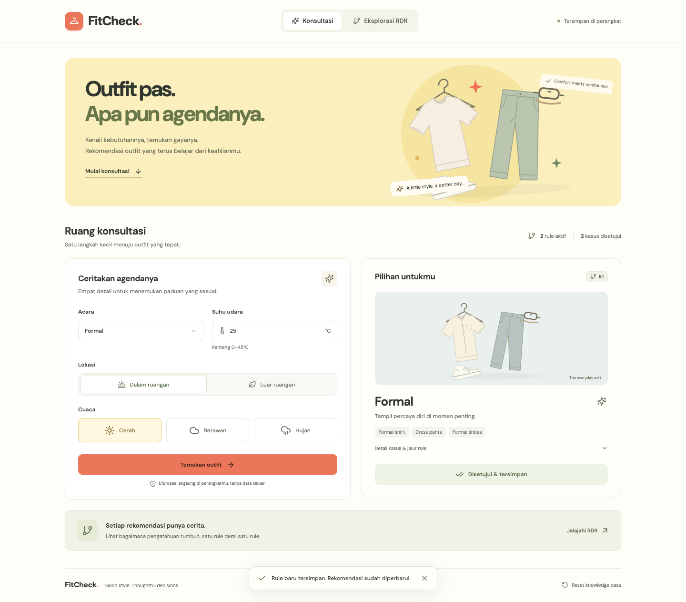
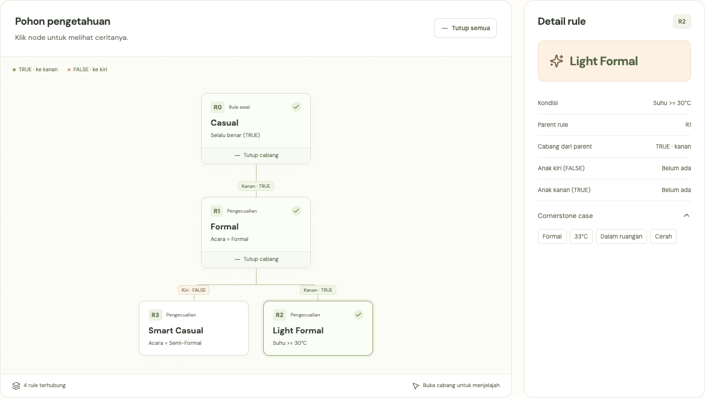
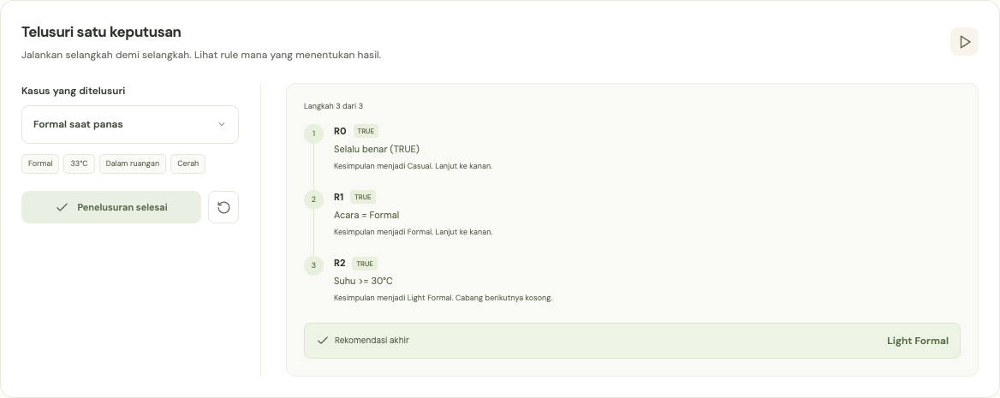

# FitCheck

**Sistem pakar rekomendasi outfit berbasis Ripple Down Rules.**

FitCheck membantu pakar busana menentukan rekomendasi pakaian berdasarkan kebutuhan konsumen. Pakar dapat menyetujui hasil atau mengoreksinya dengan aturan pengecualian. Setiap koreksi memperluas basis pengetahuan, sementara keputusan pada kasus yang telah disetujui tetap diperiksa agar konsisten.



## Fitur

- **Konsultasi outfit** berdasarkan acara, suhu udara, lokasi, dan cuaca.
- **Empat kategori rekomendasi:** Casual, Smart Casual, Formal, dan Light Formal, masing-masing disertai contoh paduan pakaian.
- **Koreksi oleh pakar** melalui kondisi pembeda dan perbandingan dengan kasus acuan (*cornerstone case*).
- **Eksplorasi RDR interaktif:** buka cabang pohon, pilih simpul untuk melihat detail, dan telusuri keputusan selangkah demi selangkah.
- **Mode contoh terpisah** untuk mencoba empat skenario tanpa mengubah basis pengetahuan pengguna.
- **Penyimpanan lokal** untuk aturan dan kasus yang telah disetujui, disertai pemulihan data tidak valid dan pengaturan ulang.

Seluruh inferensi berjalan di peramban. Aplikasi tidak memerlukan akun, backend, atau layanan AI eksternal.

## Menjalankan aplikasi

Gunakan Node.js 22.12 atau lebih baru dan npm.

Dari direktori repositori:

```sh
npm install
npm run dev
```

Buka alamat lokal yang ditampilkan Vite, biasanya `http://127.0.0.1:5173`.

Untuk membuat dan melihat build produksi, jalankan dari root repositori:

```sh
npm run build
npm run preview
```

## Alur penggunaan

1. Isi acara, suhu udara, lokasi, dan cuaca, kemudian pilih **Temukan outfit**.
2. Periksa kategori rekomendasi, contoh pakaian, dan jalur aturan yang digunakan.
3. Pilih **Setujui** apabila hasil sesuai. Persetujuan menyimpan kasus tanpa menambahkan aturan.
4. Jika hasil perlu diperbaiki, pilih **Koreksi**, tentukan kategori yang tepat, lalu pilih kondisi pembeda.
5. Simpan aturan baru. Sistem memeriksa kondisi dan keputusan kasus lama, kemudian memperbarui rekomendasi jika koreksi valid.
6. Buka **Eksplorasi RDR** untuk melihat hubungan antaraturan atau menjalankan simulasi penelusuran.

Basis pengetahuan baru hanya berisi `R0: TRUE → Casual`. Sebelum membuat pengecualian pertama, setujui satu kasus yang sesuai dengan Casual untuk menyimpan kasus acuan R0.

### Atribut konsultasi

| Atribut | Jenis | Nilai yang didukung |
|---|---|---|
| Acara | Kategorikal | Casual, Semi-Formal, Formal |
| Suhu udara | Numerik | 0–45°C |
| Lokasi | Kategorikal | Indoor, Outdoor |
| Cuaca | Kategorikal | Sunny, Cloudy, Rainy |

## Cara kerja RDR

Aturan disimpan sebagai data dalam pohon biner. Setiap simpul memiliki kondisi, kesimpulan, dua referensi anak, dan kasus acuan.

- **TRUE:** perbarui kesimpulan, lalu lanjutkan ke anak kanan.
- **FALSE:** pertahankan kesimpulan sebelumnya, lalu lanjutkan ke anak kiri.
- **Cabang kosong:** hentikan penelusuran dan kembalikan kesimpulan terakhir yang diperoleh.

Koreksi menambahkan aturan pada cabang kosong terakhir yang dicapai saat penelusuran. Kondisinya harus benar pada kasus baru dan salah pada kasus acuan dari kesimpulan yang dikoreksi. Sistem mengevaluasi ulang seluruh kasus yang telah disetujui; penambahan ditolak jika mengubah keputusan kasus tersebut.

Kondisi kategorikal mendukung `=` dan `!=`. Kondisi numerik mendukung `>`, `>=`, `<`, dan `<=`. Setiap aturan pengecualian menggunakan satu kondisi atomik.

### Contoh pertumbuhan pengetahuan

Setelah tiga koreksi pakar, pohon dapat berkembang menjadi:

```text
R0: TRUE → Casual
└── TRUE: R1 [Acara = Formal] → Formal
    ├── FALSE: R3 [Acara = Semi-Formal] → Smart Casual
    └── TRUE:  R2 [Suhu >= 30] → Light Formal
```

Untuk lokasi dalam ruangan dan cuaca cerah, pohon tersebut menghasilkan:

| Acara | Suhu | Rekomendasi |
|---|---|---|
| Casual | 25°C | Casual |
| Formal | 25°C | Formal |
| Formal | 33°C | Light Formal |
| Semi-Formal | 25°C | Smart Casual |

Pohon empat aturan ini juga tersedia melalui **Contoh interaktif** pada halaman Eksplorasi RDR.

Pohon pengetahuan dapat dibuka bertahap. Pilih simpul untuk melihat kondisi, kesimpulan, dan kasus acuannya.



Simulasi menampilkan evaluasi setiap aturan dan perubahan kesimpulan hingga rekomendasi akhir diperoleh.



## Struktur proyek

```text
./
├── src/
│   ├── engine/rdr.js                 # Inferensi, akuisisi aturan, dan validasi
│   ├── components/
│   │   ├── CorrectionPanel.jsx       # Koreksi dan perbandingan kasus acuan
│   │   ├── RDRPage.jsx               # Pohon interaktif dan simulasi
│   │   └── OutfitArt.jsx             # Ilustrasi outfit berbasis SVG
│   ├── App.jsx                      # Konsultasi dan state aplikasi
│   └── styles.css                   # Tampilan responsif
├── public/                          # Aset dan font lokal
├── docs/                            # Panduan pengembangan dan gambar dokumentasi
├── tests/                           # Pengujian logika dan browser
├── qa/                              # Screenshot dan laporan verifikasi
└── report/                          # Dokumentasi teknis PDF dan LaTeX
```

Antarmuka menggunakan React, Vite, Tailwind CSS, dan Lucide. Logika RDR dipisahkan dari komponen antarmuka dan menggunakan JavaScript.

## Pengujian

Jalankan pengujian logika dari root repositori:

```sh
npm test
```

Untuk pengujian browser, jalankan `npm run dev`, kemudian buka terminal lain pada direktori yang sama:

```sh
npm run qa
```

Pengujian browser menggunakan Playwright dan Google Chrome yang terpasang. Alamat aplikasi dapat diatur melalui `QA_URL`; kanal browser melalui `QA_BROWSER`. Pemeriksaan mencakup alur konsultasi, koreksi, penyimpanan, interaksi RDR, tampilan responsif, dan audit aksesibilitas otomatis dengan axe.

[Lihat laporan verifikasi dan screenshot](qa/QA-REPORT.md).

## Penyimpanan dan cakupan

Aturan dan kasus validasi disimpan dalam LocalStorage dengan kunci `fitcheck.rdr.v1`. Data terpisah untuk setiap peramban, perangkat, dan asal situs; sinkronisasi antarperangkat tidak tersedia. **Reset knowledge base** menghapus aturan tambahan dan kasus tersimpan setelah konfirmasi.

Rekomendasi mengikuti aturan yang ditetapkan pakar. Aplikasi tidak menganalisis foto pakaian, mengambil cuaca secara otomatis, atau mencari produk dari marketplace.
